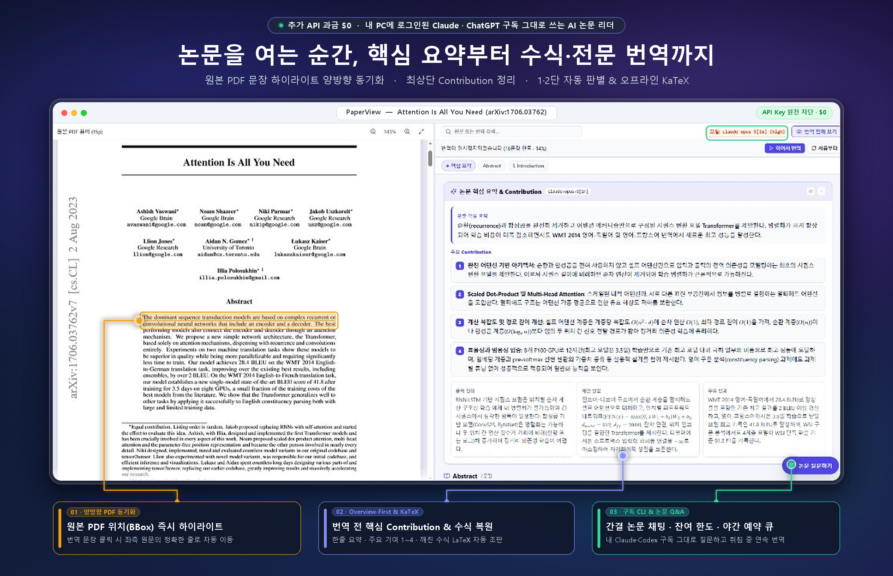
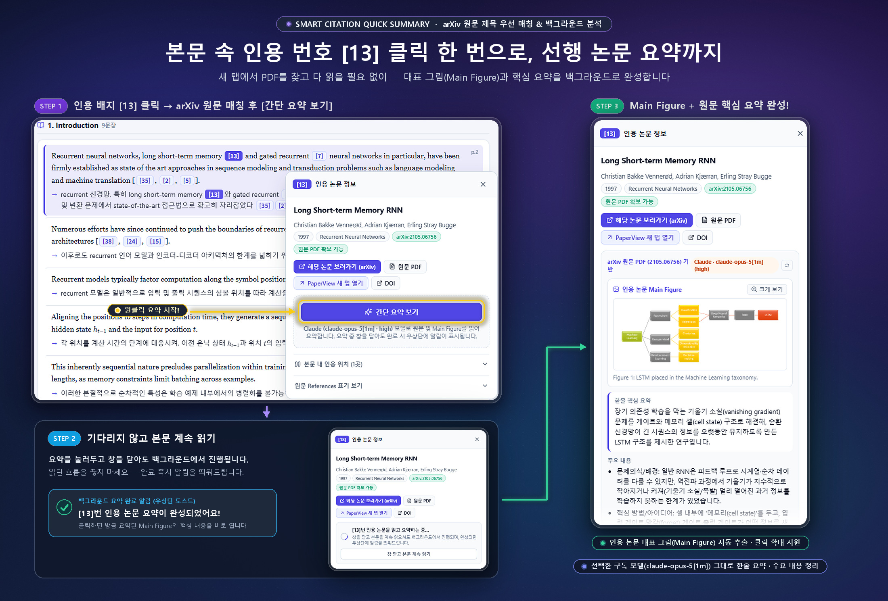

<div align="center">



<br />

# 📖 PaperView

**내 구독 그대로 쓰는 AI 학술 논문 리더**

[](https://www.python.org/)
[](https://react.dev/)
[](https://fastapi.tiangolo.com/)
[](#)
[](#)

[**한국어**](README.md) · [**English**](README.en.md) · [인용 논문 간단 요약](#-원클릭-인용-논문-간단-요약-보기) · [주요 기능](#-주요-기능) · [30초 시작하기](#-30초-빠른-시작-quick-start) · [감사의 글](#-감사의-글-acknowledgments)

</div>

---

## 💡 PaperView가 무엇인가요?

**PaperView**는 별도의 종량제 API 크레딧 발급이나 충전 없이, 로컬 PC에 로그인된 **Claude Code CLI(`claude`)** 및 **OpenAI Codex CLI(`codex`)** 구독 세션을 직접 활용해 동작하는 오픈소스 학술 논문 리더(웹 앱 + VS Code 확장)입니다. 백엔드에서 `ANTHROPIC_API_KEY`와 `OPENAI_API_KEY` 환경변수를 원천 차단하므로 **실수로라도 추가 API 요금이 청구되지 않으며, 모든 논문과 번역 캐시는 100% 내 PC 로컬 디스크(`.paperview_data/`)에만 보관됩니다.**

단순한 PDF 번역기가 아니라, 연구자가 논문을 읽는 실제 흐름 그대로 설계되었습니다:
1. 논문을 열자마자 **한줄 핵심 요약과 주요 Contribution 1·2·3·4, 문제 정의·제안 방법·주요 성과**를 최상단에 먼저 정리해 보여주고,
2. 본문 속 인용 번호(`[13]`)를 누르면 **`✨ 간단 요약 보기`** 하나로 인용 논문의 **arXiv 원문 PDF·Main Figure·핵심 요약**까지 논문을 벗어나지 않고 바로 확인할 수 있습니다.

---

## 🔎 원클릭 인용 논문 `간단 요약 보기`

<div align="center">
  
</div>

<br />

논문을 읽다가 낯선 선행 연구(`[13]`)가 나왔을 때 새 탭을 열어 PDF를 찾고 처음부터 읽을 필요가 없습니다:

1. **STEP 1 — 인용 배지(`[13]`) 클릭 & `arXiv` 원문 자동 매칭**: 참고문헌이 학회지·저널로만 적혀 있어도 먼저 **논문 제목으로 arXiv 공식 인덱스를 검색**해 열람 가능한 원문 PDF(`arXiv:2105.06756`, `원문 PDF 확보 가능`)와 바로가기 링크를 연결합니다.
2. **STEP 2 — 기다리지 않는 논블로킹 백그라운드 요약**: **`✨ 간단 요약 보기`** 를 누른 뒤 **`창 닫고 본문 계속 읽기`** 로 읽던 논문에 그대로 집중하세요. 백그라운드 요약이 끝나면 우상단에 즉시 완료 토스트 알림이 표시됩니다.
3. **STEP 3 — `Main Figure` 자동 추출 + 원문 핵심 요약 완성**: 현재 선택된 구독 모델(예: `claude-opus-5[1m] · high`) 그대로 인용 논문의 원문 PDF를 분석해 **대표 그림(`Main Figure` 확대 지원) + 한줄 핵심 요약 + 주요 내용(문제의식·핵심 방법)** 을 한눈에 정리해 줍니다.

---

## ✨ 주요 기능

### ✦ 1. 논문 번역 전 `핵심 요약 & Contribution` 기능
- 논문을 열면 긴 본문에 들어가기 전에 초록·서론·방법론·실험·결론을 가로질러 **한줄 핵심 요약(TL;DR) + 주요 Contribution + 문제 정의 / 제안 방법 / 주요 성과** 카드를 가장 먼저 띄웁니다.
- 요약 카드가 완성되는 즉시 그 아래로 `Abstract` → `1. Introduction` → ... 전문 번역이 실시간으로 이어지며, 중간에 멈췄다가 **`이어서 번역`** 으로 언제든 재개할 수 있습니다.

### 📖 2. 자연스러운 번역
- **완벽한 읽기 순서**: 심사 워터마크(`FOR REVIEW ONLY`), 머리말·쪽번호 노이즈를 제거하고 페이지마다 1단/2단/혼합 구조를 자동 판별해 순서 꼬임이 없습니다.
- **자연스러운 학술 한국어**: 문장을 인위적으로 쪼개지 않고 온전한 영어 원문(Full Sentence) 아래에 `→` 화살표와 함께 연구자에게 자연스러운 평어체(`~한다`, `~이다`) 및 현장 용어(`baseline`, `follow-up`, `ablation` 등)를 살려 번역합니다.
- **원본 PDF 양방향 동기화 & Figure·Table 추출**: 문장을 클릭하면 좌측 원본 PDF의 정확한 줄(`BBox`)이 주황색으로 하이라이트되고, Figure와 Table은 고해상도 PNG(`180~200 DPI`)로 자동 크롭되어 본문 흐름 안에 삽입됩니다.

### 🌙 3. 취침 예약 · 연속 자동 번역 큐 (Overnight Queue)
- 자기 전에 내일 읽을 PDF 논문 여러 개(또는 arXiv ID 목록)를 큐에 올려두고 **예약 시각(예: `02:00`)** 을 걸어두세요.
- 밤새 5시간 구독 한도에 도달하더라도 멈추지 않고 **완료된 청크 지점까지 체크포인트로 저장한 뒤, 한도 초기화 후 자동으로 이어서** 아침까지 모든 논문을 완성해 둡니다.

### 💬 4. 논문 기반의 채팅 & 실시간 한도 체크
- **AI 채팅 (`논문 질문하기`)**: 본문·캡션·참고문헌 전체를 바탕으로 핵심 4~6줄 내외로 명쾌하게 답변하며(`간결 | 상세` 스위치 지원), 경계선 드래그로 채팅창 크기를 자유롭게 조절할 수 있습니다.
- **무토큰 사용량 게이지**: 상단 바에서 현재 사용 중인 단일 모델·추론 강도(`low`~`max`) 전환은 물론, 토큰 소모 없이 **현재 5시간 세션 및 주간 남은 구독 한도(`%`)** 를 실시간으로 확인합니다.

---

## 🚀 Quick Start

### 사전 준비 (최초 1회)
- **Python 3.10+** 및 **Node.js 18+** 설치
- 사용하는 AI 구독 CLI 로그인 (택 1 또는 모두 사용 가능)
  ```bash
  # Claude Pro / Max 구독자
  claude auth login

  # ChatGPT Plus / Pro 구독자 (npm i -g @openai/codex 설치 후)
  codex login
  ```

### Installation
수동으로 가상환경을 만들거나 패키지를 설치할 필요가 없습니다. 실행 스크립트가 첫 실행 시 **가상환경 생성 → 패키지 설치 → 프론트엔드 빌드 → 로컬 서버 기동(`127.0.0.1:8787`) → 브라우저 실행**까지 모두 자동으로 수행합니다. *(두 번째 실행부터는 1초 만에 바로 켜집니다.)*

**Windows**
```powershell
git clone https://github.com/GangsuKim/paper-view.git
cd paper-view
.\start.bat          # 포트 변경 시: .\start.bat --port 9000
```

**macOS / Linux / WSL**
```bash
git clone https://github.com/GangsuKim/paper-view.git
cd paper-view
chmod +x start.sh
./start.sh           # 포트 변경 시: ./start.sh --port 9000
```

### VS Code / Antigravity IDE 내부에서 쓰기
프로젝트 폴더를 VS Code에서 열고 **`F5`** 를 누르거나 확장 프로그램을 실행한 뒤, 탐색기에서 아무 `.pdf` 논문 파일을 우클릭 → **`PaperView로 논문 열기`** 를 선택하면 에디터 탭 안에서 바로 열립니다.

---

## 🙏 감사의 글 (Acknowledgments)

본 프로젝트는 Google의 연구자 지원 프로그램([Antigravity for Science](https://antigravity.google/use-cases/science/))을 통해 제공받은 **Google Antigravity**로 제작되었습니다.

---

## 🤝 기여 및 라이선스 (Contributing & License)

이슈 제보, 새로운 레이아웃 케이스 공유, 기능 제안 PR을 언제든 환영합니다!
본 프로젝트는 오픈소스 **MIT License**로 배포됩니다.
