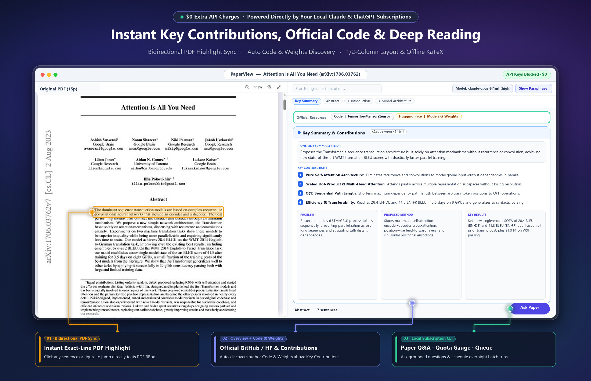
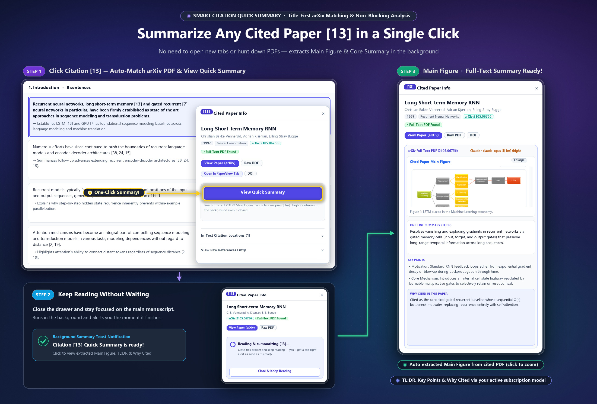

<div align="center">



<br />

# 📖 PaperView

**An AI Academic Paper Reader Powered Directly by Your Existing Subscriptions**

[](https://gangsu.kim/demo/paper-view/) [](https://www.python.org/)
[](https://react.dev/)
[](https://fastapi.tiangolo.com/)
[](#)
[](https://gangsu.kim/demo/paper-view/)
[](#)

[**🚀 Live Interactive Demo (8 Languages)**](https://gangsu.kim/demo/paper-view/) · [**English**](README.md) · [**한국어**](README.ko.md) · [Citation Quick Summary](#-one-click-citation-quick-summary) · [Key Features](#-key-features) · [Quick Start](#-quick-start) · [Acknowledgments](#-acknowledgments)

</div>

> **🚀 Try it right in your browser — Zero Install:** Open the **[Live Interactive Demo (8 Languages)](https://gangsu.kim/demo/paper-view/)** to explore ***"Attention Is All You Need"*** (Vaswani et al.) end-to-end before installing — complete with full text & LaTeX math, bidirectional PDF sync, **Author's Core Claim** cards across all 9 Figures & Tables, curated paper Q&A, and instant **one-click summaries & citation reasons for all 40 cited papers** across **8 languages** (`EN` · `KO` · `JA` · `ZH-CN` · `ZH-TW` · `ES` · `DE` · `FR`), pre-generated with **Gemini 4 Carbon**.

---

## 💡 What is PaperView?

**PaperView** is an open-source academic paper reader (Web App + VS Code Extension) that runs directly on your local **Claude Code CLI (`claude`)** and **OpenAI Codex CLI (`codex`)** subscription sessions without requiring separate pay-as-you-go API credits. Because the backend blocks `ANTHROPIC_API_KEY` and `OPENAI_API_KEY` environment variables at the source, **you never incur accidental extra API charges, and all papers and translation caches remain 100% on your local disk (`.paperview_data/`)**.

More than a simple PDF translator, PaperView is designed around how researchers actually read papers:
1. The moment you open a paper, it surfaces **author-released official Code (`GitHub`) and Pretrained Model Weights / Datasets (`🤗 Hugging Face`)** right above a **one-line TL;DR, Key Contributions 1–4, Problem, Method, and Key Results** card,
2. Beneath every **Figure and Table**, it automatically displays **what core claim the authors want to demonstrate** by synthesizing citing body paragraphs and internal plot/table values by default, and
3. Clicking any inline citation badge (`[13]`) lets you inspect the cited paper's **arXiv full-text PDF, Main Figure, and Quick Summary** in one click without ever leaving the paper.

---

## 🔎 One-Click Citation `Quick Summary`

<div align="center">
  
</div>

<br />

Whenever you encounter an unfamiliar prior work (`[13]`), there is no need to open new tabs, hunt down the PDF, and read it from scratch:

1. **STEP 1 — Click Inline Citation Badge (`[13]`) & Auto-Match `arXiv`**: Even when a reference is listed only under a conference or journal venue, PaperView **searches the official arXiv index by paper title first** to link an accessible full-text PDF (`arXiv:2105.06756`) alongside direct navigation links.
2. **STEP 2 — Non-Blocking Background Summarization**: After clicking **`✨ View Quick Summary`**, press **Close & Keep Reading** to stay focused on the main text. Once background summarization finishes, a completion toast appears immediately at the top right.
3. **STEP 3 — Auto-Extracted `Main Figure` + Core Summary**: Using your currently selected subscription model (e.g. `claude-opus-5[1m] · high`), PaperView analyzes the cited paper's full-text PDF to organize its **representative Main Figure (with click-to-zoom), one-line TL;DR, Key Points, and Why Cited** at a glance.

---

## ✨ Key Features

### ✦ 1. Pre-Translation `Key Summary & Contributions`
- Before diving into a long manuscript, PaperView synthesizes the abstract, introduction, method, experiments, and conclusion into a top **One-Line Summary (TL;DR) + Key Contributions + Problem / Method / Results** card first.
- As soon as the overview card finishes, full-text reading and translation (`Abstract` → `1. Introduction` → ...) stream in real time directly underneath, and you can pause and click **Resume** anytime.

### 🔗 2. Official `Code` & `Model Weights` Auto-Discovery (`GitHub` · `Hugging Face`)
- **PDF Hyperlink & Context Analysis**: Automatically inspects embedded PDF `/URI` annotations (recovering full URLs even when broken across two-column line wraps) and pre-reference body/footnote text to surface **author-provided source code (`GitHub` / `GitLab` / `Code Ocean`), pretrained model weights, datasets, and demos (`🤗 Hugging Face`), and project pages**, while filtering out baseline or third-party framework links.
- **Post-Upload `arXiv` Metadata Enrichment**: Even when an `arXiv` preprint PDF was uploaded *before* the authors released their code or weights, PaperView cross-checks official `Hugging Face Papers` metadata and verifies author ownership so you only get genuine official repositories and weights at the top of the reader.

### 💡 3. Default Figure & Table `Author's Core Claim` Explanations
- Beyond literal caption translation, every inline high-DPI (`180–200 DPI`) Figure and Table combines **the body sentences citing that figure/table across the paper with internal plot/table labels and scores**.
- Automatically displays a callout card **by default** beneath every Figure and Table explaining **why the authors included it and what key comparison or takeaway to look for** (generated inline during live streaming and batch-filled in a single pass for previously saved papers).

### 📖 4. Natural Multilingual Academic Reading (8 Languages for UI & AI)
- **Accurate Reading Order**: Automatically strips review watermarks (`FOR REVIEW ONLY`), headers, and page-number noise while detecting single-column, two-column, and hybrid layouts per page so reading order never scrambles.
- **8 Scholarly Languages & Localized UI**: Switch anytime between **English, Korean, Japanese, Simplified Chinese, Traditional Chinese, Spanish, German, and French** in the top bar—both the app interface and AI overviews, translations, figure insights, citation summaries, and chat adapt to natural academic phrasing in that language, with caches stored separately per language.
- **Bidirectional PDF Sync**: Clicking any sentence or figure card jumps to and highlights the exact corresponding region (`BBox`) on the original PDF on the left with a clear focus ring.

### 🌙 5. Scheduled Overnight Queue
- Queue up multiple PDF papers (or arXiv IDs) you plan to read tomorrow and set a **scheduled start time (e.g. `02:00`)** before going to sleep.
- Even if your 5-hour subscription window fills up overnight, PaperView **saves a checkpoint at the last completed chunk and automatically resumes once your quota resets**, finishing every paper by morning.

### 💬 6. Paper-Grounded Chat & Live Quota Check
- **AI Chat**: Answers clearly in 4–6 concise lines grounded in the full text, captions, and references (with a `Concise | Detailed` toggle) inside a freely drag-resizable chat drawer.
- **Zero-Token Usage Gauge**: Switch your active model and reasoning effort (`low`–`max`) from the top bar and check your **remaining 5-hour session and weekly subscription quota (`%`)** in real time without spending a single token.

---

## 🚀 Quick Start

### Prerequisites (One-Time)
- **Python 3.9+** (`3.10+` recommended) and **Node.js 18+** installed
- Sign in to your preferred AI subscription CLI (one or both):
  ```bash
  # For Claude Pro / Max subscribers
  claude auth login

  # For ChatGPT Plus / Pro subscribers (after npm i -g @openai/codex)
  codex login
  ```

### Install & Run (One-Click `git clone`)
No need to manually create virtual environments or install packages. On first run, the launcher script automatically handles **virtual environment creation → package installation → frontend build → local server startup (`127.0.0.1:8787`) → browser launch**. *(From the second run onward, it launches in 1 second.)*

**Windows**
```powershell
git clone https://github.com/GangsuKim/paper-view.git
cd paper-view
.\start.bat          # Custom port: .\start.bat --port 9000
```

**macOS / Linux / WSL**
```bash
git clone https://github.com/GangsuKim/paper-view.git
cd paper-view
chmod +x start.sh
./start.sh           # Custom port: ./start.sh --port 9000
```

> **Launcher Flags**: `--port <number>` (default `8787`), `--host <address>` (default `127.0.0.1`), `--no-browser` (skip auto-opening browser)

### Using Inside VS Code / Antigravity IDE
Open the project folder in VS Code and press **`F5`** (or launch the extension), then right-click any `.pdf` paper in the Explorer → select **`Open Paper with PaperView`** to read directly inside an editor tab.

---

## 🙏 Acknowledgments

This project was built with **Google Antigravity**, provided through Google's researcher support program ([Antigravity for Science](https://antigravity.google/use-cases/science/)).

---

## 🤝 Contributing & License

Bug reports, tricky PDF layout cases, and feature PRs are always welcome!
This project is released under the open-source **MIT License**.
